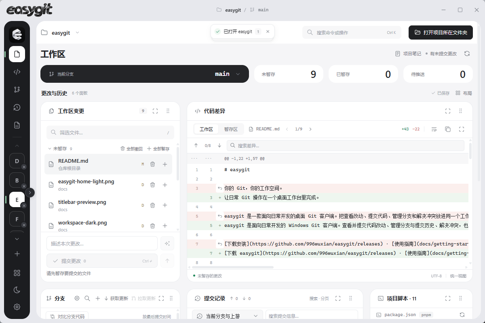
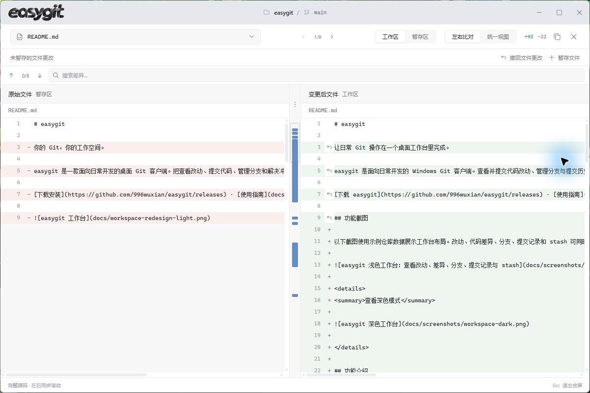
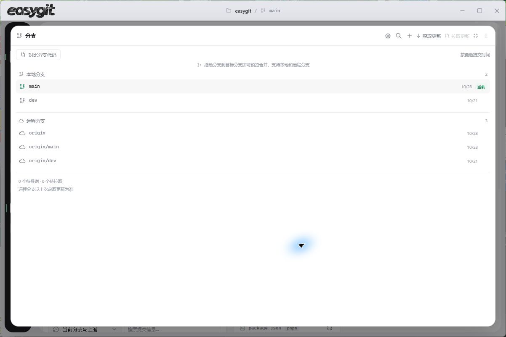
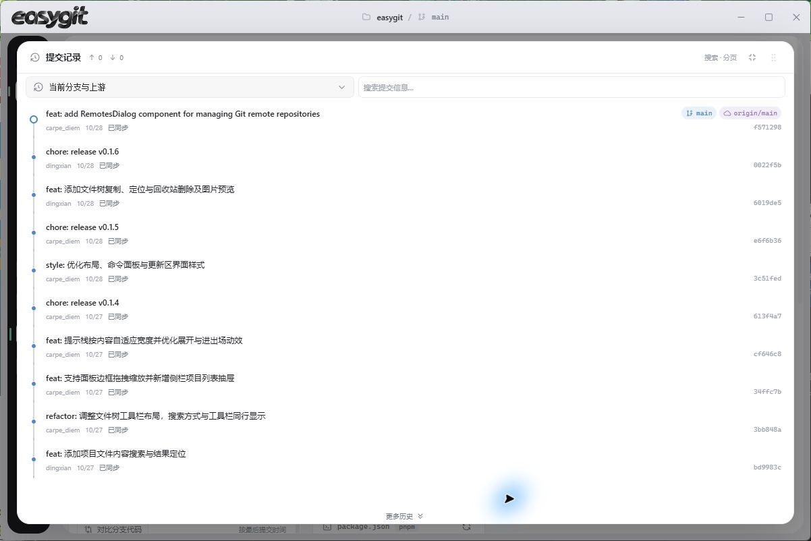

<h1 align="center">
  
</h1>

<p align="center"><strong>把变更、分支、提交历史和项目工具，放进一个顺手的 Git 工作台。</strong></p>

<p align="center">
  
  
  
  
</p>

<p align="center">
  <a href="https://github.com/996wuxian/easygit/releases"><strong>下载 Windows 版</strong></a>
  · <a href="docs/getting-started.md">使用指南</a>
  · <a href="https://github.com/996wuxian/easygit/issues">反馈与建议</a>
</p>

## 真实界面

下面的图片来自当前运行的 easygit。工作台可以同时摆放多个面板，也可以按个人习惯调整布局。

<p align="center">
  <a href="docs/screenshots/workspace-overview.png"></a>
</p>

<table>
  <tr>
    <td width="50%" valign="top">
      <a href="docs/screenshots/code-diff.jpg"></a>
      <p><strong>代码差异</strong><br />统一视图或左右比对；搜索差异、跳转变更块，再按文件暂存或撤回。</p>
    </td>
    <td width="50%" valign="top">
      <a href="docs/screenshots/branches.jpg"></a>
      <p><strong>分支管理</strong><br />查看本地和远程分支、设置上游、比较代码；拖动分支可先预览合并。</p>
    </td>
  </tr>
  <tr>
    <td colspan="2" align="center">
      <a href="docs/screenshots/history.jpg"></a>
      <p><strong>提交历史</strong><br />沿提交图浏览分支历史，搜索提交信息、切换范围、加载更多记录。</p>
    </td>
  </tr>
</table>

## easygit 能做什么

| 日常工作 | 功能 |
| --- | --- |
| **检查并提交改动** | 分开查看工作区和暂存区；筛选、多选和批量暂存文件；预览后按文件或变更块撤回；保存提交草稿、提交并推送。 |
| **比较代码** | 统一差异或全屏左右比对；同步滚动、搜索差异、跳转变更块；查看文件差异并预览暂存或撤回操作。 |
| **管理分支与远程** | 创建、切换、重命名和删除本地分支，浏览远程跟踪分支，设置上游；比较分支并拖动预览合并。远程配置支持添加、修改和移除。 |
| **查看提交历史** | 提交图、分支范围筛选、提交信息搜索和分页；查看提交详情、比较任意两个提交、拣选或反向提交，也可撤回尚未推送的末次提交。 |
| **处理冲突与 stash** | 按块保留当前版本、传入版本或双方，也可手动编辑结果；暂存后继续或取消 merge、rebase、cherry-pick、revert。stash 支持未跟踪文件、差异预览和恢复。 |
| **浏览项目并运行脚本** | 文件树支持文件名、路径和内容搜索；内置文本编辑器；读取根目录 `package.json` 脚本并在项目终端执行。 |
| **布置自己的工作台** | 八种面板可显示、隐藏、换位、缩放和最大化；布局自动保存。支持多项目、项目笔记、浅色／深色主题和系统托盘。 |
| **生成提交信息** | 可选配置兼容的 AI 服务，根据已暂存差异生成提交信息；差异会发送到所配置的服务，API Key 在 Windows 上由系统加密保存。 |

打开仓库时先显示本地状态，再后台获取远程信息。**获取不会自动拉取或合并代码**；拉取时才会将上游更新合并到当前分支。

## 下载与快速开始

目前提供 **Windows x64 中文安装包**。

1. 从 [Releases 下载 easygit](https://github.com/996wuxian/easygit/releases) 并安装 `easygit_*_x64-setup.exe`。
2. 确保本机已安装 [Git for Windows](https://git-scm.com/downloads)，且 `git` 已加入 PATH。
3. 打开 easygit，选择打开已有仓库、克隆远程仓库，或初始化本机项目。

| 开始方式 | 适用情况 |
| --- | --- |
| **打开仓库** | 已有 Git 仓库或 worktree。 |
| **克隆仓库** | 从 HTTPS、SSH 或本机路径克隆；显示阶段进度，可取消并重试，不会覆盖同名目录。 |
| **初始化仓库** | 为已有文件夹启用 Git；原有文件会保留，不会自动创建首次提交。 |

私有仓库沿用本机 Git 凭据管理器或 SSH 密钥。不要把密码或访问令牌写入仓库地址。安装版使用 Windows WebView2；应用内可检查更新，安装前请先从系统托盘退出 easygit。

## 常用快捷键

| 快捷键 | 操作 |
| --- | --- |
| `Ctrl + O` | 打开仓库 |
| `Ctrl + K` | 搜索命令，包括克隆、初始化和远程配置 |
| `Ctrl + R` | 刷新仓库状态 |
| `Ctrl + Enter` | 提交已暂存更改 |
| `/` | 聚焦变更文件筛选 |
| `Ctrl + S` | 保存编辑器中的文件 |
| `Escape` | 关闭对话框或还原最大化面板 |

## 当前限制

- 暂存以文件为单位，暂不支持分块／选行暂存和交互式 rebase 编排。
- 差异预览和文本编辑主要支持 2 MiB 以内的 UTF-8 文件。较大文件、其他编码，以及符号链接和子模块冲突需使用外部工具处理。
- 多远程仓库可分别查看；界面支持新增、修改单个获取地址和移除远程。多获取地址或独立推送地址的调整请使用 Git 命令。
- 文件编辑草稿在正常切换和退出时会提示未保存内容，暂不支持异常退出后的自动恢复。

## 开发

技术栈：Tauri 2、React 19、TypeScript、Vite、Rust、CodeMirror 和 Tabler Icons。

需要 Node.js 22.12 或更高版本、Rust 和 Git；Windows 构建还需要 C++ Build Tools 与 WebView2。

```powershell
npm ci
npm run tauri:dev
```

只预览前端界面可运行 `npm run dev`，然后打开 `http://127.0.0.1:1437`。本地 Git 操作、目录选择和文件编辑需要桌面运行环境。

<details>
<summary>完整验证与打包命令</summary>

```powershell
npm run check
npm run test:release
cargo fmt --manifest-path src-tauri/Cargo.toml --check
cargo test --offline --manifest-path src-tauri/Cargo.toml --lib
cargo clippy --offline --manifest-path src-tauri/Cargo.toml --all-targets -- -D warnings
npm run tauri:build
```

</details>

[使用指南](docs/getting-started.md) · [架构说明](docs/architecture.md) · [性能与测量](docs/performance.md) · [发布与更新](docs/releasing.md)

## 反馈

欢迎通过 [GitHub Issues](https://github.com/996wuxian/easygit/issues) 提交问题或建议。报告问题时请附上应用版本、Git 版本、操作步骤和错误信息，并隐藏仓库地址中的凭据及其他私人内容。

作者：[996wuxian](https://github.com/996wuxian)
