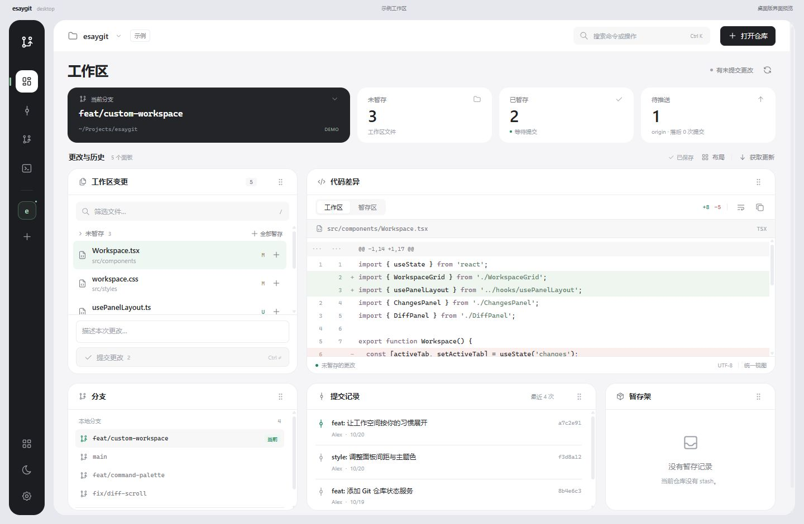

# easygit

你的 Git，你的工作空间。参考 doTime 的 **Tauri 2 + React 19 + TypeScript + Vite + Tabler Icons** 骨架，为桌面 Git 工作流提供可以自由组合的面板。



## 运行

需要 Node.js 22.12 或更高版本、Rust、Git，以及 Tauri 在 Windows 上所需的 C++ Build Tools 和 WebView2。

```powershell
npm ci
npm run tauri:dev
```

浏览器预览：

```powershell
npm run dev
```

访问 http://127.0.0.1:1437 。未打开仓库时显示空白起始页；打开本地仓库需要运行桌面版。

## 当前版本

- React 加载前即显示品牌 loading，完成启动检查后淡出。
- 自定义无边框标题栏、浅色/深色主题、Tabler 图标。
- 偏好设置中的“关于与更新”展示作者、当前版本、仓库与下载地址；桌面端启动时检查一次正式版本，支持手动检查和下载安装包，下载完成后手动运行更新。
- 最小化保留任务栏图标；关闭窗口会收起到系统托盘并从任务栏隐藏，保留当前工作区和草稿；点击托盘图标重新打开，右键可选择“显示窗口”或“退出 easygit”。真正退出前会等待本地数据保存。
- 七个独立面板：工作区变更、代码差异、分支、提交记录、暂存架、操作记录、项目脚本。
- 工作区状态左侧的“项目笔记”可记录待办、环境配置和排查心得；内容按项目独立自动保存到本机数据目录，关闭弹窗或重启后保留。
- 项目脚本面板读取根目录 `package.json` 的 `scripts`，识别 `packageManager` 或锁文件中的 npm / pnpm / yarn / bun，点击运行图标在项目目录打开终端执行；终端保留输出，可在终端中按 Ctrl + C 停止。
- 拖动面板标题右侧手柄交换位置；选中手柄后按 Alt + 方向键也可移动；Escape 取消拖动。
- 面板显示/隐藏、恢复默认布局、版本化本地布局保存；至少保留一个面板。
- Ctrl + K 命令面板、Ctrl + O 打开仓库、Ctrl + R 刷新仓库、`/` 筛选文件。
- 通过手动输入路径或系统原生文件夹选择器打开真实 Git 仓库，支持最近打开记录及 worktree；取消选择会保留原路径。
- 侧栏和打开仓库弹窗均可移除工作区，统一二次确认；移除当前项目后回到起始页，仅清理应用记录，保留本地项目和 Git 数据。
- 真实仓库状态、统一 diff 与全屏左右比对；差异页支持整文件或单个变更块撤回（预览确认后执行），保留其他修改与已暂存内容；支持暂存与取消暂存。
- 冲突文件可查看当前/传入版本，逐块保留一方或双方、手动编辑合并结果，保存后标记已解决并暂存；修改/删除与二进制冲突支持整文件选边。
- 提交、切换与创建本地分支、fetch 和 pull；pull 遇到冲突时可从工作区打开冲突解决工具。
- 分支右键菜单支持切换、复制名称、本地分支重命名和删除、设置或取消上游；远程分支可设为当前本地分支的上游。Shift + F10 也可打开菜单。修改前确认并核对分支状态；删除仅允许已合并到当前分支且未被 worktree 占用的本地分支。
- 点击远程分支可切换到对应的本地跟踪分支，没有时自动创建；保留已有本地提交，切换不自动拉取或合并，未提交更改遵循 Git 自身的保护规则。
- 本地和远程分支均可作为拖拽合并的来源与目标，预览待合并提交后确认合并。远程目标会复用对应的本地跟踪分支，没有时在确认后创建；落后时先快进同步，分叉时提示先处理。本地已有提交会保留，合并完成后手动推送。远程内容以上次“获取更新”为准。
- stash 支持保存（可包含未跟踪的新文件）、列表、代码预览、恢复保留、恢复删除与确认删除；恢复时保留原有暂存状态，冲突时保留 stash 记录。
- 合并冲突解决并暂存后可直接“完成合并”，也可确认取消；外部启动的 rebase、cherry-pick、revert 支持继续、跳过当前提交和取消，执行前重新核对仓库状态。
- 提交详情可逐文件查看只读代码差异，合并提交以第一父提交为基准；分支面板可对比任意本地或远程分支的文件与代码，无需切换分支。
- 提交记录右键可“设为对比基准”，再右键另一条记录“与基准提交对比”；基准在翻页、搜索和切换历史分支时保留，支持跨分支提交对比、交换方向和逐文件查看累计代码差异。
- 提交记录默认展示最近 10 条，按需展开为每页 25 条；支持按提交信息搜索及选择本地、远程分支。分页期间分支位置变化会提示重新刷新。
- 已推送的普通提交支持反向提交并保留共享历史；撤回到暂存区或工作区仍限制为尚未推送的当前分支末次提交。
- 提交记录右键可将其他分支的一条普通提交拣选到当前本地分支，确认来源和目标后创建带来源标记的新提交；要求工作区干净，冲突时可解决后继续、跳过或取消，空拣选可跳过。暂不支持指定主线的合并提交拣选。
- 提交信息中按 Ctrl + Enter 提交；提交草稿按仓库隔离，隐藏面板不会丢失草稿。
- 同一仓库操作串行执行；Git 子进程有超时和 Windows 进程树清理。
- 真实仓库在窗口可见且有焦点时自动刷新，持续无变化时按 8、16、30 秒放缓；隐藏到托盘时暂停轮询，恢复窗口立即检查。
- 打开或切换项目后先展示本地内容，再自动后台 fetch，更新远程分支、提交记录和领先/落后数量；网络失败保留本地内容，可点击“获取更新”重试。此过程不拉取或合并代码。

暂未包含逐行暂存和交互式 rebase 编排。应用内冲突编辑和只读差异预览支持 2 MB 以内的 UTF-8 文本；符号链接、子模块和更大文件的冲突需在外部工具中处理。解决冲突并暂存后，使用操作提示条继续当前 Git 操作；普通 stash 冲突没有独立的继续操作，解决后按正常流程提交即可。

## 验证与打包

作者：[996wuxian](https://github.com/996wuxian) · 仓库：[easygit](https://github.com/996wuxian/easygit) · 下载：[GitHub Releases](https://github.com/996wuxian/easygit/releases)。

已配置 GitHub Actions 验证和 Windows x64 中文安装包发布。版本以 `package.json` 为准，推送 main 的版本变更、推送匹配版本的 `v*` 标签，或手动运行 **Release Windows** 后自动打包并发布。版本同步、发布说明和本机安装包路径见 [发布与更新](docs/releasing.md)。

```powershell
npm run check
npm run test:release
cd src-tauri
cargo fmt --check
cargo test --offline --lib
cargo clippy --offline --all-targets -- -D warnings
```

Windows 原生托盘检查（会短暂显示独立测试窗口，不读取用户项目或本地应用数据）：

```powershell
cargo run --offline --example tray_smoke
```

在项目根目录打包：

```powershell
npm run tauri:build
```

生成不含安装包的独立调试程序（嵌入前端资源，无需 Vite）：

```powershell
npm run tauri -- build --debug --no-bundle
```

## 项目组织

```text
src/
  components/      # 业务面板、对话框、窗口控制
  layout/          # 布局模型、持久化、Pointer Events 拖动
  services/        # Git 接口、统一仓库状态与操作
src-tauri/src/
  git.rs           # Git 执行器、仓库状态、工作流
  lib.rs           # 类型化 Tauri commands
```

添加或替换面板的步骤见 [架构说明](docs/architecture.md)。
